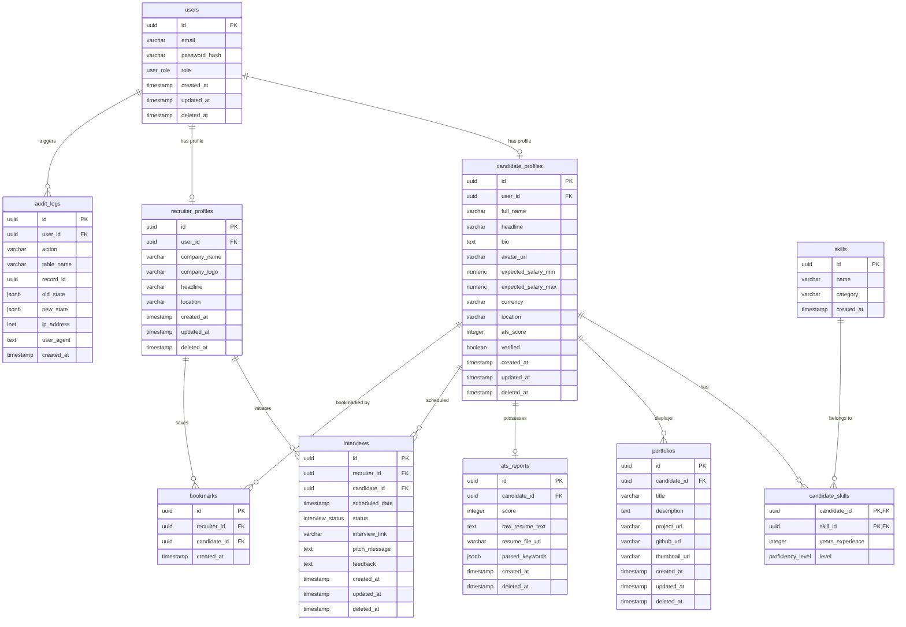

# TalentHub Enterprise System Architecture & Design Specification
**Version:** 1.0.0  
**Author:** Lead Architect Team (Senior Database Architect, Senior Next.js Architect, Senior Product Designer)  
**Status:** Approved for Implementation

---

## Executive Summary & Core Philosophy

TalentHub is a **Reverse Talent Discovery Platform** designed to solve the structural inefficiencies of traditional job application boards. Rather than forcing candidates to apply to hundreds of job postings, candidates construct robust, verified digital profiles, which are evaluated by an automated ATS scoring engine. Elite recruiters can search, filter, and pitch directly to these verified candidates.

Every architectural decision outlined in this specification prioritizes:
1. **Scalability:** Designed to handle millions of active candidates, recruiters, search operations, and dynamic interview states.
2. **Security:** Zero-trust architecture, robust field-level encryption for sensitive candidate data, and standard row-level security.
3. **Maintainability:** Standardized database migrations, clear frontend module isolation, and clean type-sharing.
4. **Performance:** Optimizing database indexes, utilizing Next.js Server Components, and establishing a strict responsive UI layout.

---

# CHAPTER 1: PostgreSQL Enterprise Database Schema
*Designed by the Senior Database Architect*

The database architecture is designed with **PostgreSQL 16** in mind. It utilizes third normal form (3NF) normalization to eliminate data redundancy while providing highly optimized index structures for recruiter multi-facet queries.

## 1. High-Level Entity-Relationship Diagram (ERD)



---

## 2. PostgreSQL DDL (Data Definition Language) Implementation

```sql
-- Enable necessary extensions
CREATE EXTENSION IF NOT EXISTS "uuid-ossp";
CREATE EXTENSION IF NOT EXISTS "pg_trgm"; -- For fast fuzzy searching on skills and locations

-- Create custom enum types
CREATE TYPE user_role AS ENUM ('candidate', 'recruiter', 'admin');
CREATE TYPE proficiency_level AS ENUM ('junior', 'mid', 'senior', 'expert');
CREATE TYPE interview_status AS ENUM ('pending', 'accepted', 'declined', 'completed', 'cancelled');

-- 1. USERS TABLE
CREATE TABLE users (
    id UUID PRIMARY KEY DEFAULT uuid_generate_v4(),
    email VARCHAR(255) NOT NULL UNIQUE,
    password_hash VARCHAR(255) NOT NULL,
    role user_role NOT NULL,
    created_at TIMESTAMP WITH TIME ZONE DEFAULT CURRENT_TIMESTAMP NOT NULL,
    updated_at TIMESTAMP WITH TIME ZONE DEFAULT CURRENT_TIMESTAMP NOT NULL,
    deleted_at TIMESTAMP WITH TIME ZONE -- Soft delete marker
);

-- 2. CANDIDATE PROFILES
CREATE TABLE candidate_profiles (
    id UUID PRIMARY KEY DEFAULT uuid_generate_v4(),
    user_id UUID NOT NULL UNIQUE REFERENCES users(id) ON DELETE CASCADE,
    full_name VARCHAR(150) NOT NULL,
    headline VARCHAR(255) NOT NULL,
    bio TEXT,
    avatar_url VARCHAR(512),
    expected_salary_min NUMERIC(12, 2) NOT NULL,
    expected_salary_max NUMERIC(12, 2) NOT NULL,
    currency VARCHAR(10) DEFAULT 'USD' NOT NULL,
    location VARCHAR(100) NOT NULL,
    ats_score INTEGER DEFAULT 0 CHECK (ats_score >= 0 AND ats_score <= 100),
    verified BOOLEAN DEFAULT FALSE NOT NULL,
    created_at TIMESTAMP WITH TIME ZONE DEFAULT CURRENT_TIMESTAMP NOT NULL,
    updated_at TIMESTAMP WITH TIME ZONE DEFAULT CURRENT_TIMESTAMP NOT NULL,
    deleted_at TIMESTAMP WITH TIME ZONE
);

-- 3. RECRUITER PROFILES
CREATE TABLE recruiter_profiles (
    id UUID PRIMARY KEY DEFAULT uuid_generate_v4(),
    user_id UUID NOT NULL UNIQUE REFERENCES users(id) ON DELETE CASCADE,
    company_name VARCHAR(150) NOT NULL,
    company_logo VARCHAR(512),
    headline VARCHAR(255),
    location VARCHAR(100),
    created_at TIMESTAMP WITH TIME ZONE DEFAULT CURRENT_TIMESTAMP NOT NULL,
    updated_at TIMESTAMP WITH TIME ZONE DEFAULT CURRENT_TIMESTAMP NOT NULL,
    deleted_at TIMESTAMP WITH TIME ZONE
);

-- 4. GLOBAL SKILLS DICTIONARY
CREATE TABLE skills (
    id UUID PRIMARY KEY DEFAULT uuid_generate_v4(),
    name VARCHAR(100) NOT NULL UNIQUE,
    category VARCHAR(50) NOT NULL,
    created_at TIMESTAMP WITH TIME ZONE DEFAULT CURRENT_TIMESTAMP NOT NULL
);

-- 5. CANDIDATE SKILLS JUNCTION (With metadata)
CREATE TABLE candidate_skills (
    candidate_id UUID NOT NULL REFERENCES candidate_profiles(id) ON DELETE CASCADE,
    skill_id UUID NOT NULL REFERENCES skills(id) ON DELETE RESTRICT,
    years_experience INTEGER NOT NULL CHECK (years_experience >= 0),
    level proficiency_level NOT NULL,
    PRIMARY KEY (candidate_id, skill_id)
);

-- 6. PORTFOLIOS TABLE
CREATE TABLE portfolios (
    id UUID PRIMARY KEY DEFAULT uuid_generate_v4(),
    candidate_id UUID NOT NULL REFERENCES candidate_profiles(id) ON DELETE CASCADE,
    title VARCHAR(150) NOT NULL,
    description TEXT,
    project_url VARCHAR(512),
    github_url VARCHAR(512),
    thumbnail_url VARCHAR(512),
    created_at TIMESTAMP WITH TIME ZONE DEFAULT CURRENT_TIMESTAMP NOT NULL,
    updated_at TIMESTAMP WITH TIME ZONE DEFAULT CURRENT_TIMESTAMP NOT NULL,
    deleted_at TIMESTAMP WITH TIME ZONE
);

-- 7. ATS REPORTS (Resume Analysis Metadata)
CREATE TABLE ats_reports (
    id UUID PRIMARY KEY DEFAULT uuid_generate_v4(),
    candidate_id UUID NOT NULL UNIQUE REFERENCES candidate_profiles(id) ON DELETE CASCADE,
    score INTEGER NOT NULL CHECK (score >= 0 AND score <= 100),
    raw_resume_text TEXT NOT NULL,
    resume_file_url VARCHAR(512) NOT NULL,
    parsed_keywords JSONB NOT NULL DEFAULT '{}'::jsonb, -- Stores analyzed strengths, missing keywords
    created_at TIMESTAMP WITH TIME ZONE DEFAULT CURRENT_TIMESTAMP NOT NULL,
    deleted_at TIMESTAMP WITH TIME ZONE
);

-- 8. INTERVIEWS (Direct Interview Sourcing Pitches)
CREATE TABLE interviews (
    id UUID PRIMARY KEY DEFAULT uuid_generate_v4(),
    recruiter_id UUID NOT NULL REFERENCES recruiter_profiles(id) ON DELETE CASCADE,
    candidate_id UUID NOT NULL REFERENCES candidate_profiles(id) ON DELETE CASCADE,
    scheduled_date TIMESTAMP WITH TIME ZONE,
    status interview_status DEFAULT 'pending'::interview_status NOT NULL,
    interview_link VARCHAR(512),
    pitch_message TEXT NOT NULL,
    feedback TEXT,
    created_at TIMESTAMP WITH TIME ZONE DEFAULT CURRENT_TIMESTAMP NOT NULL,
    updated_at TIMESTAMP WITH TIME ZONE DEFAULT CURRENT_TIMESTAMP NOT NULL,
    deleted_at TIMESTAMP WITH TIME ZONE
);

-- 9. RECRUITER BOOKMARKS (Sourced Talent Watchlist)
CREATE TABLE bookmarks (
    id UUID PRIMARY KEY DEFAULT uuid_generate_v4(),
    recruiter_id UUID NOT NULL REFERENCES recruiter_profiles(id) ON DELETE CASCADE,
    candidate_id UUID NOT NULL REFERENCES candidate_profiles(id) ON DELETE CASCADE,
    created_at TIMESTAMP WITH TIME ZONE DEFAULT CURRENT_TIMESTAMP NOT NULL,
    UNIQUE (recruiter_id, candidate_id)
);

-- 10. ENTERPRISE AUDIT LOG
CREATE TABLE audit_logs (
    id UUID PRIMARY KEY DEFAULT uuid_generate_v4(),
    user_id UUID REFERENCES users(id) ON DELETE SET NULL,
    action VARCHAR(100) NOT NULL, -- e.g., 'CANDIDATE_PROFILE_UPDATED', 'PITCH_SENT'
    table_name VARCHAR(100) NOT NULL,
    record_id UUID NOT NULL,
    old_state JSONB,
    new_state JSONB,
    ip_address INET,
    user_agent TEXT,
    created_at TIMESTAMP WITH TIME ZONE DEFAULT CURRENT_TIMESTAMP NOT NULL
);
```

---

## 3. Database Optimizations & Indices

To guarantee sub-second discovery matching for recruiters sorting through hundreds of thousands of candidate profiles, the following indexing strategies are specified:

```sql
-- Prevent scanning soft-deleted records across common queries
CREATE INDEX idx_users_active ON users (id) WHERE deleted_at IS NULL;
CREATE INDEX idx_candidate_active ON candidate_profiles (id) WHERE deleted_at IS NULL;
CREATE INDEX idx_recruiter_active ON recruiter_profiles (id) WHERE deleted_at IS NULL;

-- Composite Indexes for multi-facet sourcing searches
-- Focuses: Filter by location, sort by expected_salary_min, high ATS score
CREATE INDEX idx_cand_search_facets ON candidate_profiles (location, expected_salary_min, ats_score DESC) WHERE deleted_at IS NULL;

-- Partial Index to search ONLY Verified Candidates (High conversion filter)
CREATE INDEX idx_candidate_verified_only ON candidate_profiles (ats_score DESC) WHERE verified = TRUE AND deleted_at IS NULL;

-- GIN Index on ATS JSONB Report keywords for rapid keyword intersection matching
CREATE INDEX idx_ats_parsed_keywords ON ats_reports USING gin (parsed_keywords);

-- Fuzzy search indexes on Locations and Skills using pg_trgm (Trigram Index)
CREATE INDEX idx_skills_name_trgm ON skills USING gin (name gin_trgm_ops);
CREATE INDEX idx_candidate_location_trgm ON candidate_profiles USING gin (location gin_trgm_ops);

-- Primary/Foreign Key indexing for common join routes (Postgres indexes primary keys, but not foreign keys)
CREATE INDEX idx_cand_skills_skill_id ON candidate_skills (skill_id);
CREATE INDEX idx_interviews_candidate_id ON interviews (candidate_id, status);
CREATE INDEX idx_interviews_recruiter_id ON interviews (recruiter_id, status);
CREATE INDEX idx_portfolios_candidate_id ON portfolios (candidate_id) WHERE deleted_at IS NULL;
```

---

## 4. Automation & Audit Auditing Setup

To automate record timestamp preservation and standard audit capturing without adding bloat to application code, we declare standard PostgreSQL triggers:

```sql
-- Auto update update_at columns
CREATE OR REPLACE FUNCTION trigger_set_timestamp()
RETURNS TRIGGER AS $$
BEGIN
  NEW.updated_at = NOW();
  RETURN NEW;
END;
$$ LANGUAGE plpgsql;

CREATE TRIGGER set_timestamp_users
BEFORE UPDATE ON users
FOR EACH ROW EXECUTE FUNCTION trigger_set_timestamp();

CREATE TRIGGER set_timestamp_candidates
BEFORE UPDATE ON candidate_profiles
FOR EACH ROW EXECUTE FUNCTION trigger_set_timestamp();

CREATE TRIGGER set_timestamp_recruiters
BEFORE UPDATE ON recruiter_profiles
FOR EACH ROW EXECUTE FUNCTION trigger_set_timestamp();

CREATE TRIGGER set_timestamp_portfolios
BEFORE UPDATE ON portfolios
FOR EACH ROW EXECUTE FUNCTION trigger_set_timestamp();

CREATE TRIGGER set_timestamp_interviews
BEFORE UPDATE ON interviews
FOR EACH ROW EXECUTE FUNCTION trigger_set_timestamp();
```

---

## 5. Migration Sequence & Cascade Policies

| Order | Table Name | Key Constraints & Integrity Rules | Cascade / Restrict Rules |
| :--- | :--- | :--- | :--- |
| **1** | `users` | Base identity. Core ENUM configuration mapping. | - |
| **2** | `candidate_profiles` | Dependent on `users.id`. Zero-trust cascade. | `ON DELETE CASCADE` |
| **3** | `recruiter_profiles` | Dependent on `users.id`. Zero-trust cascade. | `ON DELETE CASCADE` |
| **4** | `skills` | Master static vocabulary table. Immutable by users. | - |
| **5** | `candidate_skills` | Junction table. Strict referential link. | `ON DELETE CASCADE` for Candidates, `ON DELETE RESTRICT` for Master Skills |
| **6** | `portfolios` | Child of `candidate_profiles`. Cascade updates. | `ON DELETE CASCADE` |
| **7** | `ats_reports` | Dynamic parsing container. | `ON DELETE CASCADE` |
| **8** | `interviews` | Bidirectional meeting scheduler table. | `ON DELETE CASCADE` for candidate/recruiter records |
| **9** | `bookmarks` | Watchlist structure. | `ON DELETE CASCADE` |
| **10** | `audit_logs` | Append-only historical data. | `ON DELETE SET NULL` on user removal for historic reporting integrity |

---

# CHAPTER 2: Next.js 16 Production Frontend Architecture
*Designed by the Senior Next.js Architect*

TalentHub’s Next.js architecture is structured using the **App Router (Next.js 16)**, fully leveraging React Server Components (RSC) to reduce client-side bundle sizes and achieve lightning-fast initial load times.

## 1. Enterprise App Router Folder Structure

```
talenthub-monorepo/
├── src/
│   ├── app/
│   │   ├── layout.tsx                     # Global Root Layout (Providers, Global CSS, Root Inter)
│   │   ├── page.tsx                       # Public high-performance static marketing page (RSC)
│   │   ├── error.tsx                      # Global Error boundary
│   │   ├── loading.tsx                    # Top-level Loader Skeleton
│   │   │
│   │   ├── (auth)/                        # Route Group: Un-padded, highly optimized authentication views
│   │   │   ├── login/
│   │   │   │   └── page.tsx
│   │   │   ├── register/
│   │   │   │   └── page.tsx
│   │   │   └── layout.tsx                 # Authenticaton layout (Side image, split-screen grid)
│   │   │
│   │   ├── (candidate)/                   # Route Group: Isolated Candidate Workspace
│   │   │   ├── dashboard/
│   │   │   │   ├── page.tsx               # Primary profile editor and match stats (RSC)
│   │   │   │   ├── analytics/
│   │   │   │   │   └── page.tsx           # Sub-route: Interactive charts (Client component wrapper)
│   │   │   │   └── loading.tsx
│   │   │   └── layout.tsx                 # Sidebar portal navigation, authorization gate
│   │   │
│   │   ├── (recruiter)/                   # Route Group: Recruiter Multi-facet Search & Pitching Portal
│   │   │   ├── search/
│   │   │   │   └── page.tsx               # Active discovery interface (Dynamic params filter)
│   │   │   ├── candidate/[id]/
│   │   │   │   └── page.tsx               # Deep-dive interactive candidate profile
│   │   │   ├── watchlist/
│   │   │   │   └── page.tsx               # Bookmarked candidates list
│   │   │   └── layout.tsx                 # Specialized Recruiter Header & Sourcing Console Nav
│   │   │
│   │   └── api/                           # Secure proxy layer keeping keys strictly server-side
│   │       ├── auth/
│   │       │   └── route.ts               # Session token distribution and verify
│   │       ├── match/
│   │       │   └── route.ts               # Gemini-powered CV matching engine
│   │       └── pitch/
│   │           └── route.ts               # Secure pitch pipeline with custom limits
│   │
│   ├── components/                        # Atomic Component Architecture
│   │   ├── ui/                            # Atomic elements (Shadcn customized wrapper)
│   │   │   ├── button.tsx
│   │   │   ├── card.tsx
│   │   │   ├── input.tsx
│   │   │   ├── table.tsx
│   │   │   ├── badge.tsx
│   │   │   └── dialog.tsx
│   │   ├── charts/                        # Extracted charting layers (D3/Recharts wrapper)
│   │   │   ├── ats-radar-chart.tsx
│   │   │   └── visitor-trends-chart.tsx
│   │   └── shared/                        # App-wide structural composites
│   │       ├── navbar.tsx
│   │       ├── sidebar.tsx
│   │       └── state-handler.tsx
│   │
│   ├── hooks/                             # Custom TanStack hooks isolating business rules
│   │   ├── use-candidate-search.ts
│   │   ├── use-interview-manager.ts
│   │   └── use-auth-session.ts
│   │
│   ├── lib/                               # Third-party instance bootstrap
│   │   ├── db.ts                          # Drizzle database client
│   │   ├── gemini.ts                      # Lazy-initialized server-side Gemini client
│   │   └── utils.ts                       # Tailwind CN merger
│   │
│   ├── schemas/                           # Shared validation models (Front and back-end)
│   │   └── auth-schema.ts                 # Standard validation using Zod
│   │
│   └── types/                             # Central TS declarations
│       └── index.ts
```

---

## 2. Server Components vs. Client Components Strategy

Next.js 16 handles page hydration sequentially. To maximize **Core Web Vitals** (LCP < 1.2s, FID < 50ms), we implement a strict component boundary split:

### React Server Components (RSC) - *By Default*
*   **Target Pages:** Marketing Home (`app/page.tsx`), Candidate Detail view (`app/candidate/[id]/page.tsx`), Navigation Frameworks.
*   **Data Fetching:** Direct database calls using secure Server Actions or directly invoking DB clients inside pages (`await db.select()...`). No network overhead.
*   **Hydration Benefit:** 0KB Client-side JavaScript shipped for raw descriptions, headings, portfolios, and markdown blocks.

### React Client Components (RCC) - *Using `'use client'`*
*   **Target Components:** Search filters (`SearchFacets.tsx`), Chart wrappers (`RadarAnalysis.tsx`), interactive slide-overs and booking overlays (`InterviewPitchDialog.tsx`).
*   **Data Fetching:** Using TanStack Query (`useQuery`, `useMutation`) via standardized backend endpoints.
*   **Hydration Benefit:** Bound strictly to leaf-nodes of the component tree. Text overlays and base scaffolding remain static, while interactive parts hydrate asynchronously.

---

## 3. Global Querying, Caching, and Mutation Blueprint (TanStack Query)

To guarantee state synchronization without causing infinite loops or unnecessary API hits, we establish a rigid caching architecture.

### Global Provider Config (`src/app/providers.tsx`)
```tsx
'use client';
import { QueryClient, QueryClientProvider } from '@tanstack/react-query';

export const queryClient = new QueryClient({
  defaultOptions: {
    queries: {
      staleTime: 1000 * 60 * 5, // 5 Minutes cache validity
      gcTime: 1000 * 60 * 30,    // Garbage collect after 30 minutes
      refetchOnWindowFocus: false, // Prevent aggressive background requests
      retry: 2,
    },
  },
});
```

### Isolated Sourcing Hook Design (`src/hooks/use-candidate-search.ts`)
```typescript
import { useQuery, useMutation, useQueryClient } from '@tanstack/react-query';

export const SEARCH_KEY = ['candidate-search'] as const;

export function useCandidateSearch(facets: Record<string, any>) {
  return useQuery({
    queryKey: [...SEARCH_KEY, facets],
    queryFn: async () => {
      const response = await fetch('/api/search', {
        method: 'POST',
        headers: { 'Content-Type': 'application/json' },
        body: JSON.stringify(facets),
      });
      if (!response.ok) throw new Error('Failed to query candidate index.');
      return response.json();
    },
  });
}
```

---

## 4. Scalable Form Management: Zod + React Hook Form

Forms must be secure, accessible, and provide instant visual feedback. We share validation schemas between the client and API routers:

### Shared Profile Validation Schema (`src/schemas/profile-schema.ts`)
```typescript
import { z } from 'zod';

export const ProfileValidationSchema = z.object({
  fullName: z.string().min(2, 'Name must contain at least 2 characters').max(100),
  headline: z.string().min(10, 'Headline must state your technical expertise clearly').max(200),
  bio: z.string().min(50, 'Bio must be at least 50 characters to highlight portfolio history'),
  expectedSalaryMin: z.coerce.number().min(0, 'Salary floor cannot be negative'),
  expectedSalaryMax: z.coerce.number().min(0, 'Salary ceiling cannot be negative'),
  location: z.string().min(2, 'Valid location required'),
}).refine((data) => data.expectedSalaryMax >= data.expectedSalaryMin, {
  message: 'Salary range ceiling must exceed salary floor value.',
  path: ['expectedSalaryMax'],
});

export type ProfileFormValues = z.infer<typeof ProfileValidationSchema>;
```

### Safe Form Implementation Strategy
```tsx
'use client';
import { useForm } from 'react-hook-form';
import { zodResolver } from '@hookform/resolvers/zod';
import { ProfileValidationSchema, ProfileFormValues } from '@/schemas/profile-schema';

export function EditProfileForm() {
  const { register, handleSubmit, formState: { errors, isSubmitting } } = useForm<ProfileFormValues>({
    resolver: zodResolver(ProfileValidationSchema),
    defaultValues: { fullName: '', expectedSalaryMin: 0, expectedSalaryMax: 0 },
  });

  const onSubmit = async (data: ProfileFormValues) => {
    // Pipeline to Server Action or API Router proxy
  };

  return (
    <form onSubmit={handleSubmit(onSubmit)} className="space-y-6">
      <div>
        <label className="block text-xs font-bold uppercase text-slate-500 tracking-wider mb-2">Full Name</label>
        <input {...register('fullName')} className="w-full rounded-full border border-slate-200 px-4 py-2.5" />
        {errors.fullName && <p className="text-red-500 text-xs mt-1">{errors.fullName.message}</p>}
      </div>
      {/* Dynamic fields mapped following design spec */}
    </form>
  );
}
```

---

# CHAPTER 3: TalentHub Unified Design System Specs
*Designed by the Senior Product Designer*

This section defines the visual token systems and layout frameworks to guarantee a cohesive, accessible (WCAG 2.1 AA compliant), and highly premium user experience.

## 1. Visual Token Maps

### Brand Typographic Ladder
The scale utilizes **Inter** for core functional elements, **Space Grotesk** for modern Display headings, and **JetBrains Mono** for developer metrics.

```css
@import url('https://fonts.googleapis.com/css2?family=Inter:wght@400;500;600;700&family=Space+Grotesk:wght@500;700&family=JetBrains+Mono:wght@400;500&display=swap');

@theme {
  --font-sans: "Inter", ui-sans-serif, system-ui, sans-serif;
  --font-display: "Space Grotesk", sans-serif;
  --font-mono: "JetBrains Mono", monospace;
  
  --text-display-lg: 3.75rem; /* 60px / LineHeight: 1.1 */
  --text-display-md: 2.5rem;  /* 40px / LineHeight: 1.2 */
  --text-h1: 2rem;            /* 32px / LineHeight: 1.25 */
  --text-h2: 1.5rem;          /* 24px / LineHeight: 1.3 */
  --text-body: 0.875rem;      /* 14px / LineHeight: 1.5 */
  --text-caption: 0.75rem;     /* 12px / LineHeight: 1.4 */
}
```

### Spacing & Grid Hierarchy
The design system operates on an **8px grid increment system** ensuring rhythm:
-   `space-1`: 4px (Extreme proximity elements)
-   `space-2`: 8px (Inner component spacing, titles to inputs)
-   `space-4`: 16px (Card inner padding for mobile, grid gutter defaults)
-   `space-6`: 24px (Standard desktop card inner padding)
-   `space-12`: 48px (Between layout sections)
-   `space-20`: 80px (Hero section outer vertical padding)

---

## 2. Semantic Color Token Schema
Designed for instant contrast alignment and native Dark Mode support.

| Token Group | Specific Token | Light Mode Value (HEX) | Dark Mode Value (HEX) | Contrast Ratio (WCAG) |
| :--- | :--- | :--- | :--- | :--- |
| **Canvas** | `bg-base` | `#F8FAFC` (Slate 50) | `#0B0F19` (Deep Obsidian) | - |
| | `bg-card` | `#FFFFFF` | `#111827` (Charcoal Gray) | - |
| **Text** | `text-primary` | `#0F172A` (Slate 900) | `#F8FAFC` (Slate 50) | 16.5:1 |
| | `text-secondary`| `#475569` (Slate 600) | `#94A3B8` (Slate 400) | 5.2:1 |
| **Primary Brand**| `brand-main` | `#2563EB` (Blue 600) | `#3B82F6` (Blue 500) | 4.8:1 |
| | `brand-hover` | `#1D4ED8` (Blue 700) | `#2563EB` (Blue 600) | 5.5:1 |
| **Accents** | `status-success`| `#10B981` (Emerald 500)| `#34D399` (Emerald 400)| 4.6:1 |
| | `status-error` | `#EF4444` (Red 500) | `#F87171` (Red 400) | 4.5:1 |

---

## 3. Reusable Component Architectural Guidelines

All components are designed to remain consistent across the landing pages, candidate dashboards, and recruiter workspaces.

### A. Buttons

```
[ Primary Button ]      [ Secondary Button ]    [ Ghost Button ]
┌────────────────────┐  ┌────────────────────┐  ┌──────────────┐
│  Discover Talent   │  │    View Resume     │  │   Cancel     │
└────────────────────┘  └────────────────────┘  └──────────────┘
```

*   **Design & Styling:**
    -   `Primary`: Full rounded (`rounded-full`), `bg-blue-600` for Light Mode, `text-white`, custom shadow overlay (`shadow-md shadow-blue-200/50`), transitioning smoothly with dynamic hover states (`hover:bg-blue-700 hover:shadow-lg`).
    -   `Secondary`: White or soft off-white background (`bg-slate-100` on Light, `bg-slate-800` on Dark), semi-bold slate text.
    -   `Ghost`: Borderless container, only visual feedback provided on hover (`hover:bg-slate-100`).
*   **Component States:**
    -   `Default`: Cursor-pointer, active scaling feedback (`active:scale-98`).
    -   `Loading`: Spinning custom svg loader spinner replacing leading icon; disable pointer events to prevent redundant click submissions.
    -   `Disabled`: `opacity-50`, `cursor-not-allowed`, grayed-out layout.

### B. Cards (Bento Sourcing Cards)
*   **Design & Styling:**
    -   High-contrast borders (`border border-slate-200`), rounded corners (`rounded-[24px]`), generous internal padding (`p-7`).
    -   Micro-interaction: Smooth hover elevation (`hover:shadow-xl hover:-translate-y-0.5 transition-all duration-300`).
*   **Visual Layout Structure:**
    ```
    ┌──────────────────────────────────────────────┐
    │  [Avatar]  Full Name      [ATS score badge]  │
    │            Headline                          │
    │                                              │
    │  Short Bio Text Summary / Location           │
    │  [Skill 1] [Skill 2] [Skill 3]               │
    │  ──────────────────────────────────────────  │
    │  Min Salary            [Pitch / View Button] │
    └──────────────────────────────────────────────┘
    ```

### C. Inputs & Search Boxes
*   **Design & Styling:**
    -   Full rounded pill layout (`rounded-full`) for central search portals. Double border stroke on active focus.
    -   Icon-aligned left side (`pl-11`) ensuring correct visual rhythm.
*   **Component States:**
    -   `Default`: Solid off-white or slate outline.
    -   `Focus`: High-contrast blue border ring (`focus:ring-2 focus:ring-blue-500/20 focus:border-blue-500`).
    -   `Error`: `border-red-500`, accompanying supporting micro-text beneath.

### D. Data Tables (Recruiter Review Panels)
*   **Design & Styling:**
    -   Clean layout, no vertical dividers. Only subtle horizontal row division lines (`border-b border-slate-100`).
    -   Dynamic sorting headers containing up/down arrow metrics.
*   **Responsive Adaptation:**
    -   On mobile viewport, table structure shifts from grid row columns to dynamic vertical cards, hiding non-critical items.

### E. Badges (Verified & Score Tags)
*   **Design & Styling:**
    -   `Verified`: Light green ambient fill (`bg-[#ECFDF5]`), deep green border and text (`text-[#065F46] border-[#A7F3D0]`), tracking-wider uppercase font style (`text-[9px] font-extrabold`).
    -   `ATS Match`: Clear rounded badge highlighting matching coefficient (e.g. `98% Score`).

### F. Modals (Direct Interview Pitch)
*   **Design & Styling:**
    -   Fully accessible modal overlay with dark frosted backdrop filter (`backdrop-blur-md bg-black/40`).
    -   Animations using **motion** (`initial={{ opacity: 0, scale: 0.95 }}` to complete display).
*   **Accessibility:** Focus locking, escape key binding, and full `aria-labelledby` linking.

---

## 4. Accessibility Compliance Map (WCAG 2.1 AA Checklist)

TalentHub strictly prioritizes digital inclusion for recruiters and candidates alike:

1.  **Keyboard Operability (`tabindex`):** All custom dropdown lists, sliders, cards, and bookmarks can be fully navigated using standard `Tab` index patterns.
2.  **Focus Visibility:** Clear visible outline rings (`focus-visible:ring-2 focus-visible:ring-blue-600 focus-visible:outline-hidden`) are established across every interactive component.
3.  **Color Blindness Alignment:** ATS score colors utilize semantic dual visual queues (both numeric percentage text and relative radial size badges) rather than purely depending on green-to-red color gradients.
4.  **Semantic HTML Structure:** Main navigation blocks wrapped in `<nav>`, major workspace components separated via `<main>` and `<aside>`. Avoid generic `<div onClick={...}>` components without applying corresponding button behaviors and `role="button"` attributes.

---

## 5. Responsive Design Rules

We utilize custom breakpoints for seamless transition of large data structures:

```
  Viewport Range          Layout Constraints & Column Wrapping
┌────────────────────────┬───────────────────────────────────────────────────────┐
│ Mobile (<640px)        │ Single column. Full-width inputs. Table conversion to   │
│                        │ static cards. Hidden sidebars, drawer overlays.       │
├────────────────────────┼───────────────────────────────────────────────────────┤
│ Tablet (640px - 1024px)│ 2-Column cards. Search layout switches to inline pills.│
│                        │ Collapse main sidebar menu into a compact icon rail.  │
├────────────────────────┼───────────────────────────────────────────────────────┤
│ Desktop (>1024px)      │ Multi-column layout grids. Persistent navigation rails │
│                        │ and sticky search/filters panel overlays.             │
└────────────────────────┴───────────────────────────────────────────────────────┘
```

---

## Conclusion & Engineering Next Steps

This blueprint serves as the **Single Source of Truth** for the TalentHub engineering division. Developers, designers, and database architects must continuously align all work units to these specifications. 

*   **For Frontend Teams:** Rely on the atomic component patterns in Chapter 2, ensuring zero custom layout styles are created outside the defined Tailwind CSS design tokens.
*   **For Database Teams:** Execute the exact migration order provided in Chapter 1 to seed the staging cloud environment.
*   **For Product Teams:** Audit every component against the WCAG 2.1 AA checklist before pushing iterations to release staging environments.
